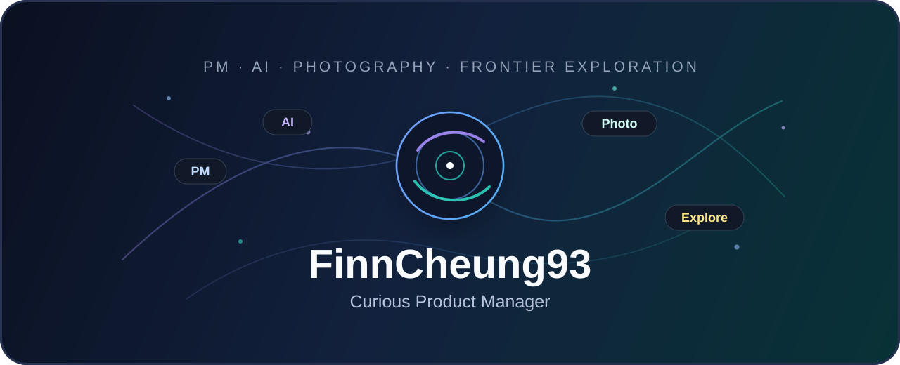

<div align="center">



<br>

[](https://git.io/typing-svg)

<br>

<p><kbd>Product Management</kbd> <kbd>AI Agent Skills</kbd> <kbd>Language 中文</kbd></p>

</div>

```text
我是一个爱探索的产品经理，关注 PM 工作流、AI、产品系统和前沿工具。
这里记录我整理的一些 AI Agent Skills，也包括我对需求、规格、原型和协作方式的持续尝试。
```

## 👋 About Me

- 产品经理，喜欢把模糊想法整理成可落地的结构
- 关注 AI Agent、PM 工作流、产品系统和前沿工具
- 喜欢摄影，也喜欢用视觉方式观察和记录世界
- 正在整理一组帮助 PM 与 AI 更好协作的 Skills

## 🧭 PM 工作流与交付

从项目开工、梳理需求到原型走查和实现验证，按手头的问题选用即可。

| 项目 | 用在什么时候 |
|---|---|
| [项目地基 · Agentic Foundation](https://github.com/FinnCheung93/agentic-foundation) | 新项目开工，或已有项目需要补齐协作规则、项目状态和长期记录时 |
| [PM PRD 助手](https://github.com/FinnCheung93/pm-prd-copilot) | 需求还没讲清楚，或需要撰写、修订和审阅 PRD 时 |
| [PM 原型助手](https://github.com/FinnCheung93/finn-protopilot) | 想把需求或设计做成能走查、能演示的原型时 |
| [Finn Codecraft](https://github.com/FinnCheung93/finn-codecraft) · 插件 | 进入实现后，需要定位缺陷、审阅改动或验证修复时 |

## 🧰 其他工具

- [验收驱动循环](https://github.com/FinnCheung93/acceptance-loop)：按验收标准审阅、返修和复验交付物，通过后再交稿。

## 📷 其他兴趣

- 摄影：喜欢观察光线、空间、情绪和日常里的细节
- 前沿探索：持续尝试 AI 工具、Agent 工作流和新的产品交互方式
- 产品系统：关注复杂信息如何被组织、表达和协作

<sub>这些仓库暂未提供开源许可证，默认保留所有权利。</sub>
